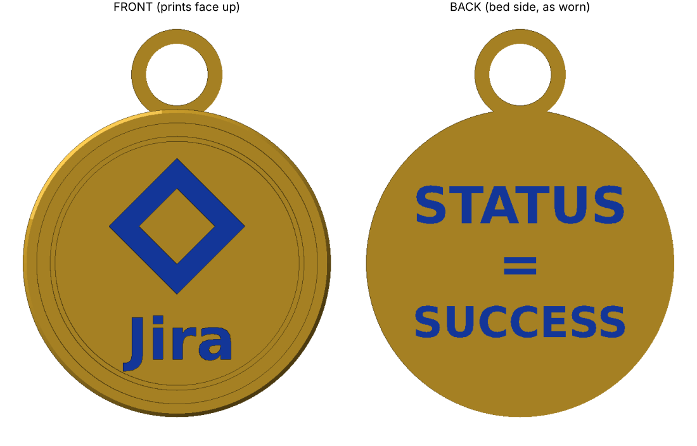
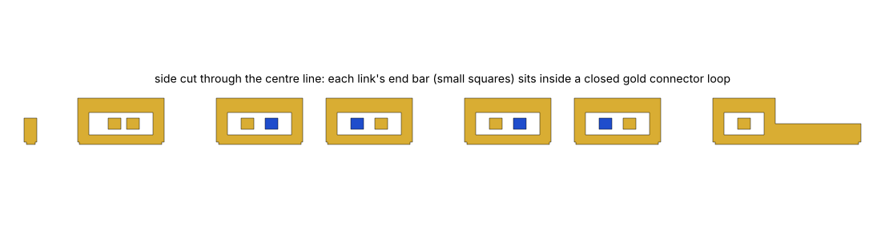
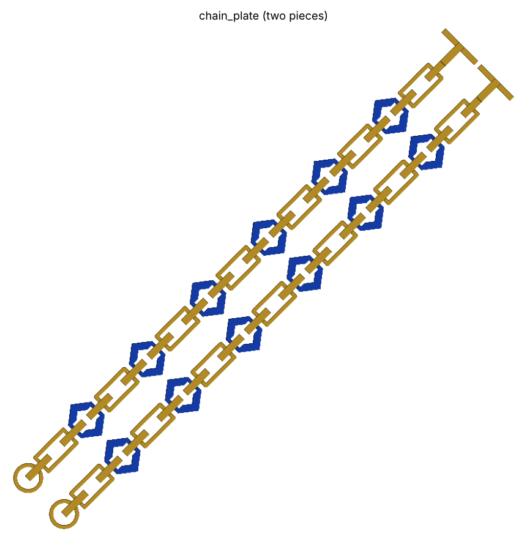
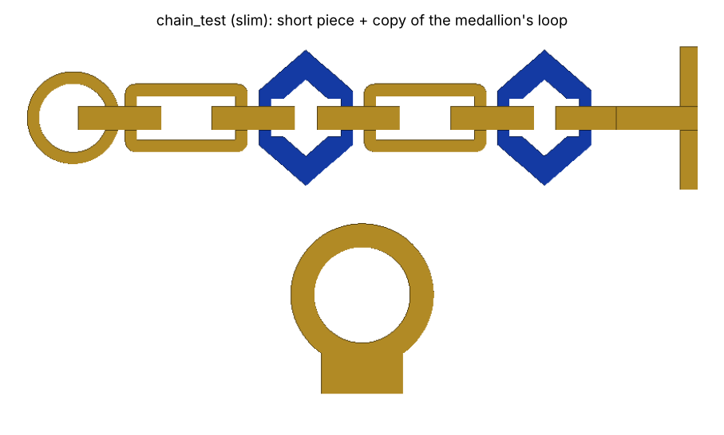
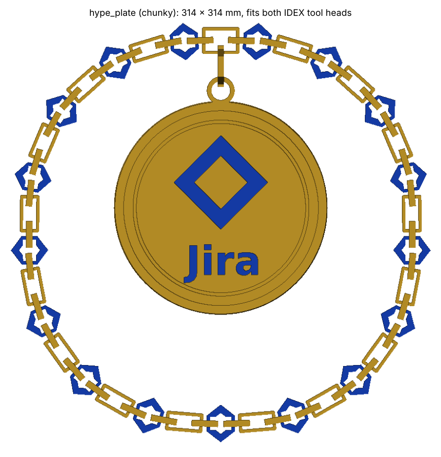
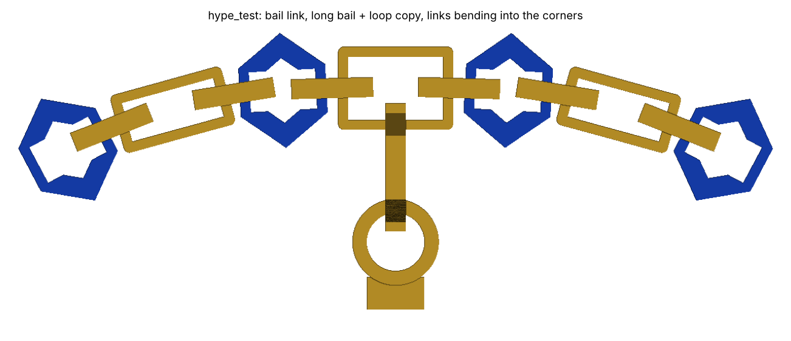
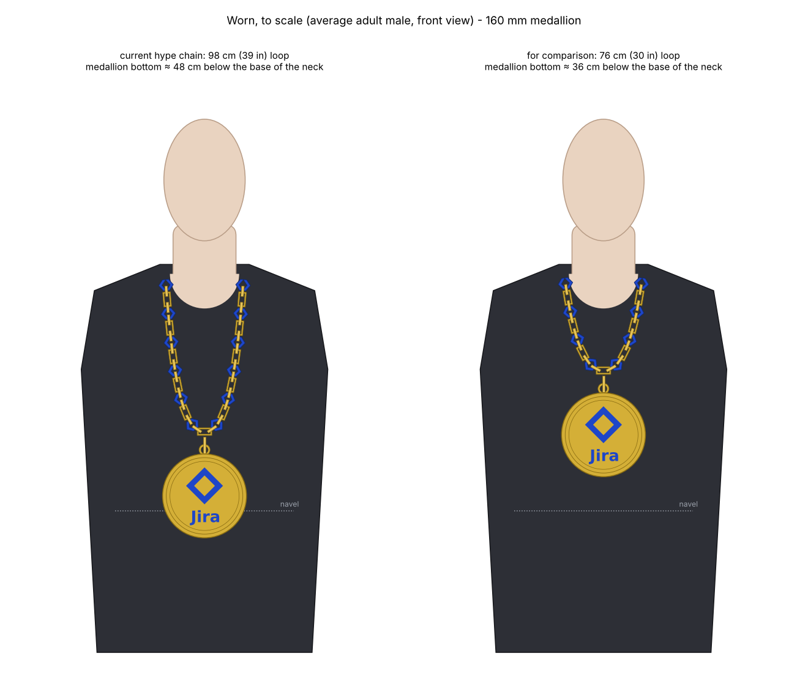

# King of Jira medallion and chain (3D printable)

A 100 mm (4 in) wearable pendant with a raised rim, a diamond emblem and raised "Jira" text on the front,
"STATUS = SUCCESS" inlaid in blue on the back, and a print-in-place chain to hang it on.



## Medallion

| File | Use |
|---|---|
| `medallion.3mf` | Gold and blue parts in one file for AMS/MMU printers (**use this for the blue diamond, "Jira" text and back text**) |
| `medallion_gold.stl`, `medallion_blue.stl` | The same parts as separate STLs (shared coordinates; load together as one multi-part object) |
| `medallion.stl` | Single-colour, one-piece print (back text is not cut in) |
| `make_medallion.py` | Parametric source |

**Size:** 100 × 118 × 5.6 mm, roughly 25–35 g of PLA. Change `DIAMETER` in `make_medallion.py` for a different size; the face artwork scales with it. The loop at the top has a 14 mm hole, the same size as the chain's toggle rings, so a chain T-bar clips straight into it.

**Print:** flat, face up, no supports, 3–4 walls, 20–30% infill.
The back text is a 0.2 mm inlay, so it is exactly the **first layer** and comes out blue on the bed side.
Set your first-layer height to 0.2 mm (or change `BACK_DEPTH` to match yours, e.g. 0.4 for two layers if gold shows through).
A textured or smooth PEI plate gives the back its finish.
Without a multi-colour printer: swap filament manually after layer 1 (blue, then gold), and again at 3.6 mm so the diamond and "Jira" come out blue (the rim and inner ring will be blue too).

## Chain

| File | Use |
|---|---|
| `chain_plate.3mf` | Both pieces with gold and blue parts, for AMS/MMU printers (**use this for blue logo links**) |
| `chain_plate_gold.stl`, `chain_plate_blue.stl` | The same two colours as separate STLs (shared coordinates) |
| `chain_plate.stl` | Both pieces, single colour (308 × 308 mm, laid diagonally for a 350 × 350 mm bed) |
| `chain_segment.stl` | One piece (398 mm long; it only fits a 350 mm bed diagonally) |
| `make_chain.py` | Parametric source (`NECKLACE_LEN`, `SEGMENTS`, `BED`, `CHAIN_SCALE`, `GAP`, `GAP_Z`, `PLAY`, `PLAY_X`, `LOGO_LINKS`) |




This is the necklace itself: about 78 cm (30 in) long, long enough to pull over your head, with a clasp so you
don't have to. It prints flat and already linked, with no supports, about 6.6 mm thick.

**Two sizes (`CHAIN_PROFILE` in `make_chain.py`):** `"slim"` (the default, what these files are) uses original-size
links, crisper diamonds and normal print-in-place gaps: about half the plastic of the chain alone. `"chunky"` uses 1.4×
links with very wide gaps and lots of slack; it was made while a misaligned tool head (shifted 1.3 mm) was fusing
parts, and its files are kept in `chunky/`. Regenerate either with `CHAIN_PROFILE=chunky python3 make_hype_chain.py`.

**How it holds together:** flat links lie on the bed and alternate between 18 mm long gold rectangles and blue diamonds
(14 × 20 mm; the medallion's logo; 10 per piece). Each end bar of a flat link is a small arch with a tunnel under it. Between
every pair of flat links is a gold connector: a closed loop standing upright whose bottom rod runs through the two
tunnels and whose top bar arches over the two end bars. So every end bar passes *through* a closed loop, just like
the links of a normal chain. The script checks that every connector and link is trapped in every direction, not just
that the parts don't touch. The only overhangs are short (~6 mm) flat bridges.
Set `LOGO_LINKS = False` for an all-gold chain.

It comes as two pieces. Each starts with a toggle ring and ends with a 17 mm stem and a T-bar,
so the necklace has exactly two joints: the clasp at the back and the medallion's joint at the front.

For a smaller bed, raise `SEGMENTS` (use an even number so a joint lands at the front) and set `BED`.

**Test print first:** `chain_test.3mf` (two colours) or `chain_test.stl` (one colour), 98 × 51 mm, about 15–20 minutes.
It's a short piece with the real ring, two gold links, two blue diamonds, the connectors, the stem and T-bar, plus a copy
of the medallion's loop. After printing, check that:
1. every link moves freely (flex each one; if any are fused, raise `GAP` / `GAP_Z` and regenerate);
2. the T-bar clips into the piece's own ring and won't pull back out;
3. the T-bar and stem go through the loop copy, as they will on the medallion.



**Print:** 0.2 mm layers, 100% infill or 4+ walls (the links are small), no brim, good bridging/cooling settings.
Clearances (slim): `GAP` = 0.7 mm side to side and `GAP_Z` = 0.8 mm above/below the short bridges, plus `PLAY`
(0.3 mm) of extra free movement sideways and `PLAY_X` (1.2 mm) of extra slack along the chain inside each connector.
Neighbouring flat links sit 1.6 mm apart on the bed, and the bottom 0.4 mm (two layers) of every part is pulled in by
0.3 mm (`FOOT_RELIEF`), a built-in elephant-foot compensation. **On a two-tool-head printer, calibrate the tool XY
offsets first:** a 1.3 mm offset between the heads is what fused the earlier test prints (the blue parts land shifted
into the gold ones). If yours can't be trusted, print single colour or use the chunky profile.

**Slicer:** supports **off**, brim **off** (Bambu Studio / Orca default to "auto" brim, which can put brim lines inside
the gaps), no "elephant foot compensation" needed on top of the built-in one.

**Assemble (toggle joints):** a T-bar goes through a ring like a toggle clasp. Push one end of the bar through the ring,
tilt it about 45° so the bar and the link behind it pass through together, then let the bar turn crosswise.
Under tension it lies across the ring and can't pull back out.

1. Take piece A's T-bar, push it through the **medallion's loop**, then through piece B's ring, and let it turn
   crosswise. The medallion's loop and the ring both ride on the stem. That joint, with the medallion on it, is the front.
2. The other T-bar and ring are the clasp at the back: clip them together around your neck (or leave it closed and
   pull it over your head).

## Hype-chain plate (medallion + closed chain, one print)



| File | Use |
|---|---|
| `hype_plate.3mf` | The whole necklace in one print, gold + blue parts for AMS/MMU printers (326 × 326 mm, fills a 350 × 350 mm bed) |
| `hype_plate_gold.stl`, `hype_plate_blue.stl` | Same two colours as separate STLs |
| `hype_plate.stl` | Single colour |
| `hype_test.3mf` / `hype_test.stl` | Test print (118 × 56 mm): the bail link, the bail, a copy of the medallion's loop, and links bending as much as the corners do |
| `make_hype_chain.py` | Parametric source (`FILL_BED`, `LOOP_LEN`, `MEDALLION_SIZE`, `MAX_JOINT_DEG`, `BED`) |

The chain prints as one closed loop that fills the bed: about 108 cm (43 in), 62 links alternating gold and blue diamonds,
with no clasp, so it goes over your head. Set `FILL_BED = False` and `LOOP_LEN` for a shorter loop
(e.g. 760 for 30 in). The medallion prints in the middle at 160 mm (6.3 in) across; the separate `medallion.*` files stay 100 mm.
Change `MEDALLION_SIZE` in `make_hype_chain.py` for another size, or set it to `"fill"` for the largest that fits
inside the loop (257 mm on a 350 mm bed). A gold **bail** prints already
linked through both: it is an upright loop whose bottom rod runs through a tunnel under the inner rail of the wider
gold "bail link" at the top of the chain and a tunnel under the top of the medallion's loop. The medallion comes off
the bed already hanging from the chain.

**Hanging it:** on the plate the medallion sits inside the loop, so when you put the necklace on it starts out pointing up
at your neck. It swings down by flipping over the chain (about 180°). The bail is long (about 21 mm, with a 45° roof
so it prints without supports) so the medallion's loop clears the bail link on the way over; `make_hype_chain.py --swing`
simulates the whole swing and checks nothing collides. Because it flips, the medallion's front ends up facing the same
way as the chain's **underside** (the side that was on the bed). So wear the chain bed-side out; the chain looks the same
from both sides.

The chain is laid out as a rounded square. Each joint on the corners is bent up to 12.5° (the slim joints can bend about 21° sideways).
Even on the bent joints every moving part has at least 0.8 mm of room side to side and 0.8 mm above/below (the
script fails below `GAP` - 0.2 / `GAP_Z` - 0.1). For that, the channel down the middle of the diamonds is a bit wider than on the
straight chain. The script checks clearance between every pair of nearby parts and that the connectors and bail
can't slide free.



Print `hype_test` first. Check that the links bend freely (including the bent ones at the ends), that the bail
moves freely through the bail link and the loop copy, that the loop copy can flip all the way over the chain,
and that nothing is fused.

### Worn preview



`make_worn_preview.py` draws the hype chain and medallion to scale on an average adult-male outline (front view),
next to a 76 cm (30 in) loop for comparison. It isn't a physics simulation: the chain goes round the back of the neck
and the front hangs as a catenary between the sides of the neck. With the current 108 cm loop the medallion's bottom
sits about 52 cm below the base of the neck (below the navel); a 76 cm loop puts it about 35 cm down (upper stomach).
The loop's inside edge is about 105 cm around (about 71 cm for a 76 cm loop); going over an adult head takes roughly
65-70 cm, so the current loop clears easily and a 76 cm loop only just does.

## Regenerate

```
pip install manifold3d trimesh shapely matplotlib networkx lxml
python3 make_medallion.py
python3 make_chain.py
python3 make_hype_chain.py           # add --swing to also simulate the medallion swinging down
python3 make_worn_preview.py
```
