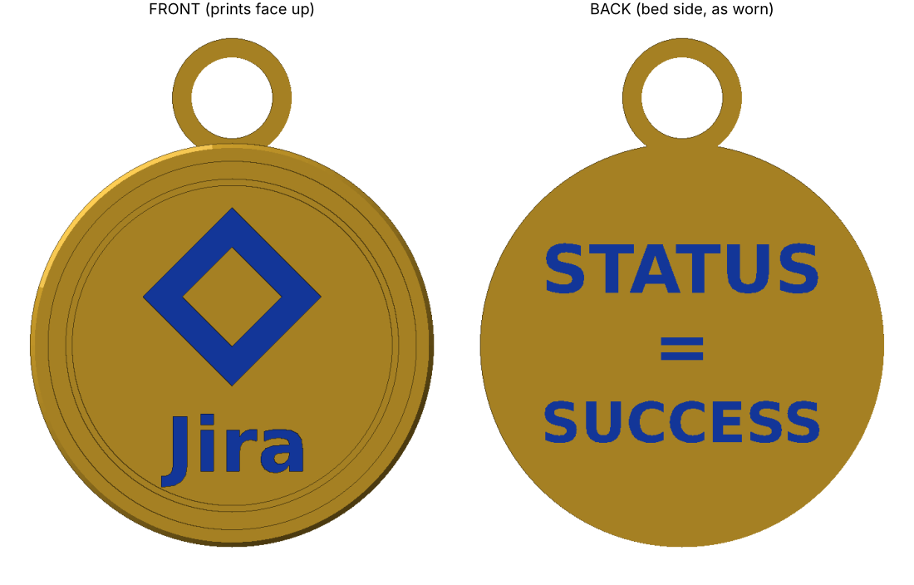
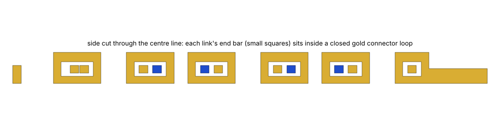
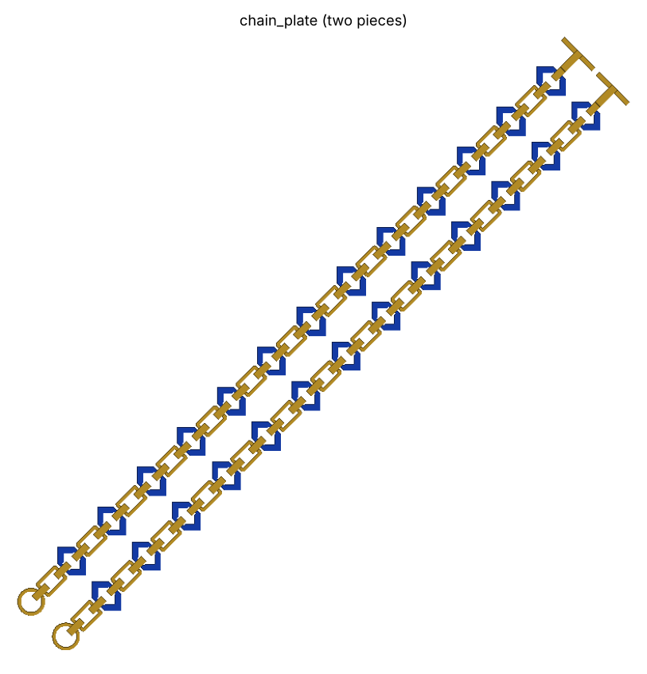
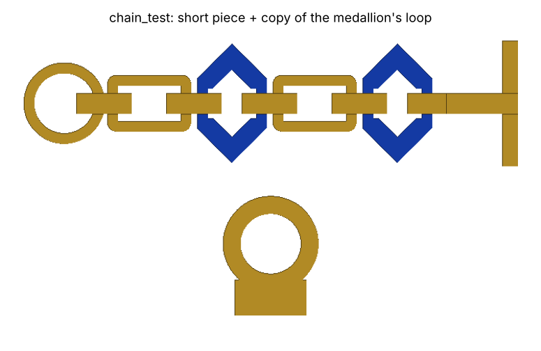
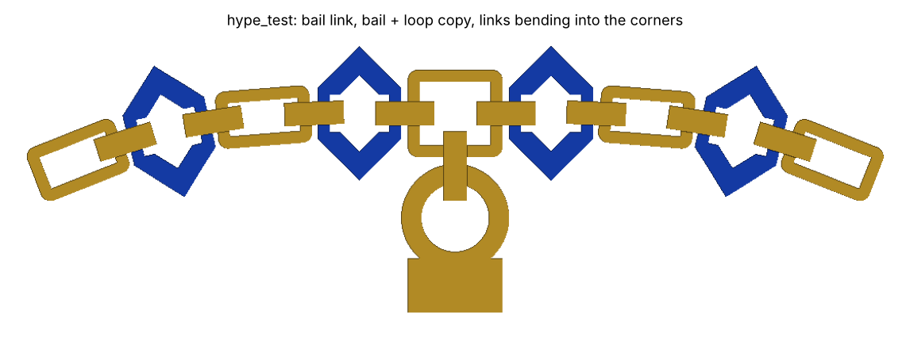

# King of Jira medallion and chain (3D printable)

A 75 mm (3 in) wearable pendant with a raised rim, a diamond emblem and raised "Jira" text on the front,
"STATUS = SUCCESS" inlaid in blue on the back, and a print-in-place chain to hang it on.



## Medallion

| File | Use |
|---|---|
| `medallion.3mf` | Gold and blue parts in one file for AMS/MMU printers (**use this for the blue diamond, "Jira" text and back text**) |
| `medallion_gold.stl`, `medallion_blue.stl` | The same parts as separate STLs (shared coordinates; load together as one multi-part object) |
| `medallion.stl` | Single-colour, one-piece print (back text is not cut in) |
| `make_medallion.py` | Parametric source |

**Size:** 75 × 89 × 5.6 mm, roughly 15–20 g of PLA. Change `DIAMETER` in `make_medallion.py` for a different size; the face artwork scales with it. The loop at the top has a 10 mm hole, the same size as the chain's toggle rings, so a chain T-bar clips straight into it.

**Print:** flat, face up, no supports, 3–4 walls, 20–30% infill.
The back text is a 0.2 mm inlay, so it is exactly the **first layer** and comes out blue on the bed side.
Set your first-layer height to 0.2 mm (or change `BACK_DEPTH` to match yours, e.g. 0.4 for two layers if gold shows through).
A textured or smooth PEI plate gives the back its finish.
Without a multi-colour printer: swap filament manually after layer 1 (blue, then gold), and again at 3.6 mm so the diamond and "Jira" come out blue (the rim and inner ring will be blue too).

## Chain

| File | Use |
|---|---|
| `chain_plate.3mf` | Both pieces with gold and blue parts, for AMS/MMU printers (**use this for blue logo links**) |
| `chain_plate_gold.stl`, `chain_plate_blue.stl` | The same two colours as separate STLs (shared coordinates) |
| `chain_plate.stl` | Both pieces, single colour (307 × 307 mm, laid diagonally for a 350 × 350 mm bed) |
| `chain_segment.stl` | One piece (396 mm long; it only fits a 350 mm bed diagonally) |
| `make_chain.py` | Parametric source (`NECKLACE_LEN`, `SEGMENTS`, `BED`, `GAP`, `LOGO_LINKS`) |




This is the necklace itself: about 77 cm (30 in) long, long enough to pull over your head, with a clasp so you
don't have to. It prints flat and already linked, with no supports, about 6 mm thick.

**How it holds together:** flat links lie on the bed and alternate between gold rectangles and 20 mm blue diamonds
(the medallion's logo; 13 per piece). Each end bar of a flat link is a small arch with a tunnel under it. Between
every pair of flat links is a gold connector: a closed loop standing upright whose bottom rod runs through the two
tunnels and whose top bar arches over the two end bars. So every end bar passes *through* a closed loop, just like
the links of a normal chain. The script checks that every connector and link is trapped in every direction, not just
that the parts don't touch. The only overhangs are short (~6 mm) flat bridges.
Set `LOGO_LINKS = False` for an all-gold chain.

It comes as two pieces. Each starts with a toggle ring and ends with a 12 mm stem and a T-bar,
so the necklace has exactly two joints: the clasp at the back and the medallion's joint at the front.

For a smaller bed, raise `SEGMENTS` (use an even number so a joint lands at the front) and set `BED`.

**Test print first:** `chain_test.3mf` (two colours) or `chain_test.stl` (one colour), 84 × 46 mm, about 10–15 minutes.
It's a short piece with the real ring, two gold links, two blue diamonds, the connectors, the stem and T-bar, plus a copy
of the medallion's loop. After printing, check that:
1. every link moves freely (flex each one; if any are fused, raise `GAP` to 0.6 and regenerate);
2. the T-bar clips into the piece's own ring and won't pull back out;
3. the T-bar and stem go through the loop copy, as they will on the medallion.



**Print:** 0.2 mm layers, 100% infill or 4+ walls (the links are small), no brim, good bridging/cooling settings.
`GAP` is 0.5 mm; if links come out fused, raise it to 0.6 and re-run the script.
Right after printing, flex every link gently to break the links free.

**Assemble (toggle joints):** a T-bar goes through a ring like a toggle clasp. Push one end of the bar through the ring,
tilt it about 45° so the bar and the link behind it pass through together, then let the bar turn crosswise.
Under tension it lies across the ring and can't pull back out.

1. Take piece A's T-bar, push it through the **medallion's loop**, then through piece B's ring, and let it turn
   crosswise. The medallion's loop and the ring both ride on the stem. That joint, with the medallion on it, is the front.
2. The other T-bar and ring are the clasp at the back: clip them together around your neck (or leave it closed and
   pull it over your head).

## Hype-chain plate (medallion + closed chain, one print)


| File | Use |
|---|---|
| `hype_plate.3mf` | The whole necklace in one print, gold + blue parts for AMS/MMU printers (253 × 253 mm) |
| `hype_plate_gold.stl`, `hype_plate_blue.stl` | Same two colours as separate STLs |
| `hype_plate.stl` | Single colour |
| `hype_test.3mf` / `hype_test.stl` | Test print (127 × 40 mm): the bail link, the bail, a copy of the medallion's loop, and links bending as much as the corners do |
| `make_hype_chain.py` | Parametric source (`LOOP_LEN`, `MAX_JOINT_DEG`, `BED`) |

The chain prints as one closed loop of about 77 cm (30 in): 54 links, alternating gold and blue diamonds,
with no clasp, so it goes over your head. The medallion prints in the middle. A gold **bail** prints already
linked through both: it is an upright loop whose bottom rod runs through a tunnel under the inner rail of the wider
gold "bail link" at the top of the chain and a tunnel under the top of the medallion's loop. The medallion comes off
the bed already hanging from the chain.

The chain is laid out as a rounded square. Each joint on the corners is bent 8.5°; the parts were checked to keep
0.3 mm clearance up to 11°. For that, the channel down the middle of the diamonds is a bit wider than on the
straight chain. The script checks clearance between every pair of nearby parts and that the connectors and bail
can't slide free.



Print `hype_test` first. Check that the links bend freely (including the bent ones at the ends), that the bail
moves freely through the bail link and the loop copy, and that nothing is fused.

## Regenerate

```
pip install manifold3d trimesh shapely matplotlib networkx lxml
python3 make_medallion.py
python3 make_chain.py
python3 make_hype_chain.py
```
