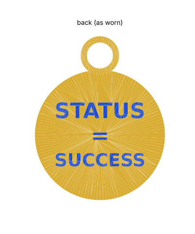

# King of Jira medallion and chain (3D printable)

A 50 mm wearable pendant with a raised rim, a diamond emblem and raised "Jira" text on the front,
"STATUS = SUCCESS" inlaid in blue on the back, and a print-in-place chain to hang it on.

 

## Medallion

| File | Use |
|---|---|
| `medallion.3mf` | Gold, blue and light-blue parts in one file for AMS/MMU printers (**use this for the blue back text**) |
| `medallion_gold.stl`, `medallion_blue.stl`, `medallion_lightblue.stl` | The same parts as separate STLs (shared coordinates; load together as one multi-part object) |
| `medallion.stl` | Single-colour, one-piece print (back text is not cut in) |
| `make_medallion.py` | Parametric source |

**Size:** 50 × 63 × 4.8 mm, about 9 g PLA. The loop at the top has a 10 mm hole, the same size as the chain's toggle rings, so a chain T-bar clips straight into it.

**Print:** flat, face up, no supports, 3–4 walls, 20–30% infill.
The back text is a 0.2 mm inlay, so it is exactly the **first layer** and comes out blue on the bed side.
Set your first-layer height to 0.2 mm (or change `BACK_DEPTH` to match yours, e.g. 0.4 for two layers if gold shows through).
A textured or smooth PEI plate gives the back its finish.
Without a multi-colour printer: swap filament manually after layer 1 (blue, then gold), and again at 3.2 mm for a coloured diamond.

## Chain

| File | Use |
|---|---|
| `chain_plate.stl` | All 4 pieces on one plate (157 × 93 mm) |
| `chain_segment.stl` | One piece, if you want to print them separately |
| `make_chain.py` | Parametric source (`NECKLACE_LEN`, `SEGMENTS`, `GAP`) |


The chain prints flat and already linked, with no supports. Flat links lie on the bed and solid bridge links arch
over them on 45° ramps. Each piece starts with a toggle ring and ends with a T-bar, and four pieces clip together into
a ~59 cm (23 in) necklace. One joint is the clasp you open to put it on.

**Print:** 0.2 mm layers, 100% infill or 4+ walls (the links are small), no brim on the links if you can avoid it.
`GAP` is 0.5 mm; if links come out fused, raise it to 0.6 and re-run the script.
Right after printing, flex every link gently to break the links free.

**Assemble (toggle joints):** a T-bar goes through a ring like a toggle clasp. Push one end of the bar through the ring,
tilt it about 45° so the bar and the link behind it pass through together, then let the bar turn crosswise.
Under tension it lies across the ring and can't pull back out.

1. Clip the four pieces into one long strand (3 joints).
2. Pick the joint that will sit at the front. Unclip it, push that T-bar through the **medallion's loop** first,
   then through the ring, and let it turn crosswise. The medallion now hangs from that joint.
3. The two loose ends are the clasp: clip that T-bar into that ring around your neck.

## Regenerate

```
pip install manifold3d trimesh shapely matplotlib networkx lxml
python3 make_medallion.py
python3 make_chain.py
```
